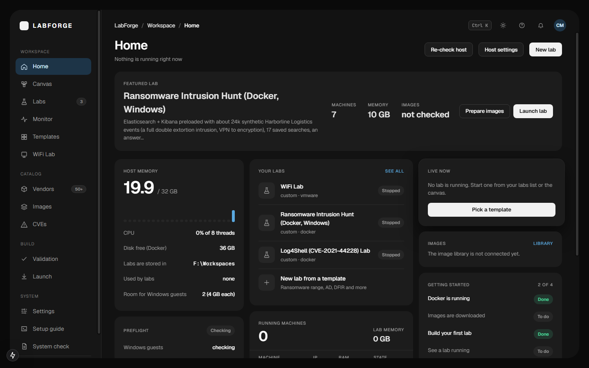
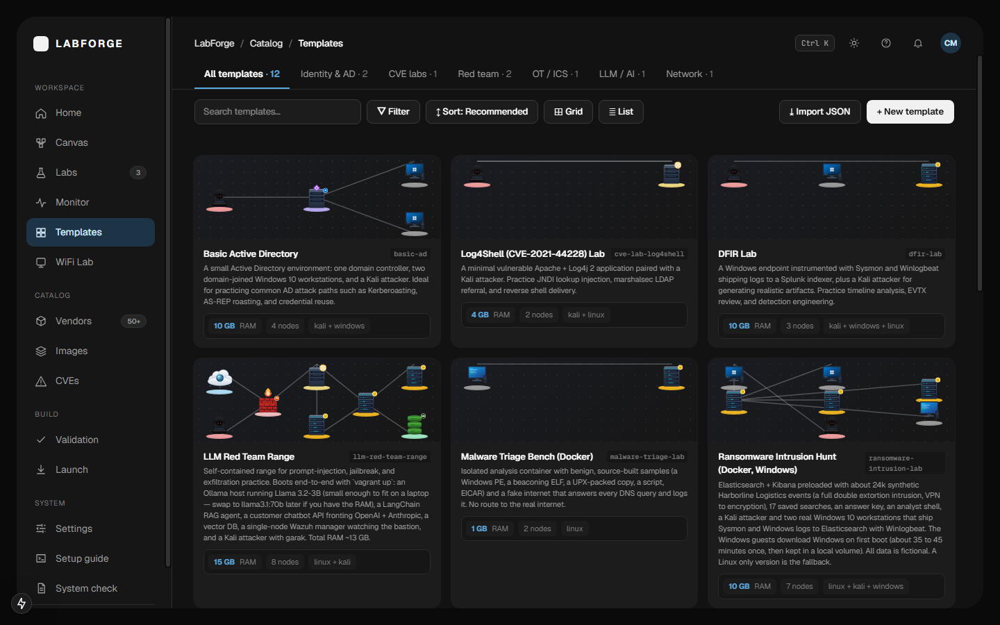
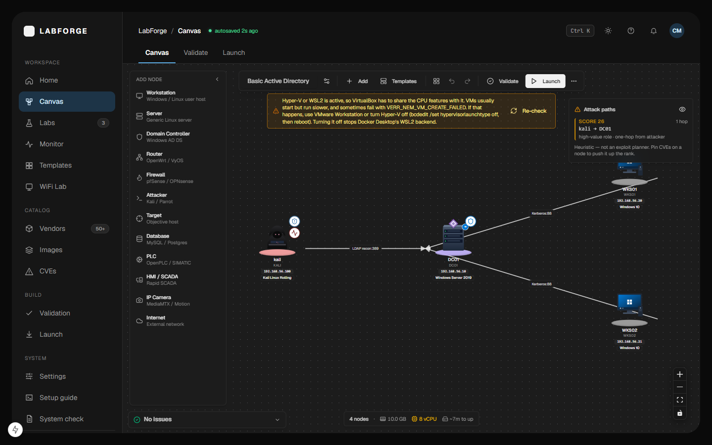
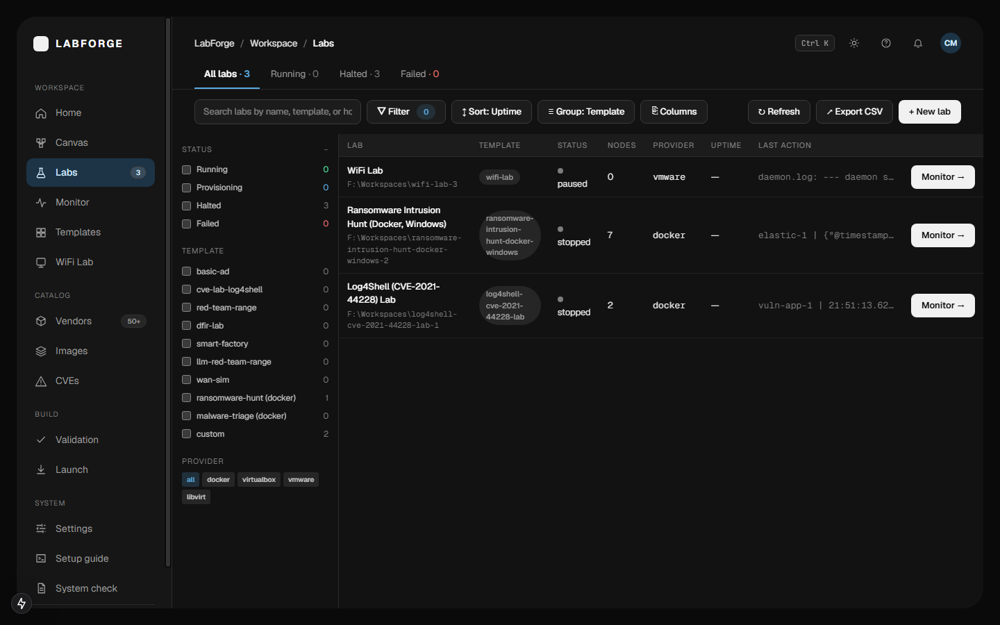
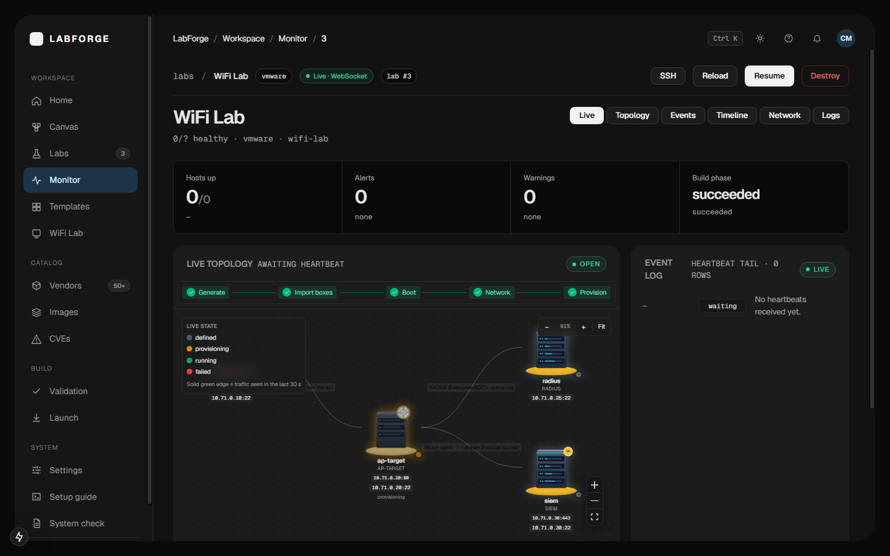

# LabForge

On-demand virtual lab generation for cybersecurity training and research.
Pick a template or draw your own topology, hit **Generate Lab**, and a real
multi-VM or multi-container range boots locally — no cloud bill, no shared
infrastructure, no waiting on a provisioning ticket.

---

## What it is

LabForge is a self-hosted platform: build a lab from a catalog of pre-made
templates (Active Directory, CVE exploitation, DFIR, ICS/OT, WiFi pentesting,
LLM red-teaming, ransomware hunting…) or sketch a custom network on the
canvas and attach roles (Splunk, Wazuh, Kali, OpenPLC…) node by node. One
dashboard handles the whole lifecycle — build, pause (freeze a lab with zero
compute cost and resume it instantly), stop, destroy — and labs that support
it (like the WiFi range) let you switch live attack scenarios with a button
instead of re-provisioning anything by hand.

Every generated lab is real infrastructure — actual VMs (Vagrant + VirtualBox
or VMware) or actual containers (Docker Compose) running the genuine
software each scenario calls for, not a simulation of it. Topology is just
JSON: version it, share it, fork it.

---

## Screenshots

**Dashboard** — active labs, host resource usage, and quick-launch templates
in one place.


**Templates** — a growing catalog across AD, CVE labs, DFIR, OT/ICS,
LLM/AI, and network simulation.


**Canvas** — drag nodes from the palette, draw edges, and get an
attack-path heuristic as you build.


**Labs** — every lab you've built, its provider, status, and a one-click
path into its live monitor.


**Monitor** — live build/heartbeat telemetry per lab, including a real-time
topology view once it's up.


---

## Quick start (under 2 minutes)

Prerequisites: **Node 20+**, **pnpm 9+**, **Python 3.12+**, **uv** (Python package installer).
Vagrant + VirtualBox/VMware are only needed for VM-based labs — the Docker-only
labs (ransomware hunt, malware triage, Log4Shell) run with just Docker.

```bash
# 1. Install Node dependencies
pnpm install

# 2. Set up Python virtual environment and dependencies
pip install uv            # install uv if you don't have it
uv venv                   # create a virtual environment (.venv)
pnpm run setup            # installs API + agent Python deps via uv

# 3. Start both services
pnpm dev                  # → API on :8010, web on :3000
```

> No `concurrently`? Run `pnpm dev:api` and `pnpm dev:web` in two terminals.
>
> On Windows (VM-based and Docker labs), follow [docs/windows-host.md](docs/windows-host.md).

Open <http://127.0.0.1:3000>, pick a template, hit **Generate Lab**.

### Or with Docker

```bash
docker compose up
```

Same two ports, no Python toolchain on your host.

---

## What's inside

| Path                 | What                                                              |
|----------------------|-------------------------------------------------------------------|
| `apps/web/`          | Next.js 15 dashboard, canvas builder, and live monitor            |
| `apps/api/`          | FastAPI backend (validate · NVD · Vagrantfile/Compose generator)  |
| `packages/schema/`   | Shared topology schema (Zod + Pydantic)                           |
| `packages/agent/`    | `labforge` CLI that drives `vagrant up` / `docker compose up`     |

The CLI is optional — everything you can do from the web UI you can do
from the API.

---

## Bundled templates

Loaded from `packages/schema/templates/`:

- `basic-ad` — DC + 2 Windows 10 workstations + Kali attacker (~10 GB)
- `cve-lab-log4shell` — Apache + Log4j 2.14 + Kali, Docker-only (~4 GB)
- `dfir-lab` — Windows endpoint + Sysmon/Winlogbeat → Splunk + Kali (~10 GB)
- `llm-red-team-range` — Ollama + LangChain RAG agent + Kali, prompt-injection/jailbreak practice (~15 GB)
- `malware-triage-lab` — isolated analysis container + fake-internet sandbox, Docker-only (~1 GB)
- `ransomware-intrusion-lab` — Elastic/Kibana SIEM hunt over a synthetic double-extortion intrusion, plus 2 real Windows victims, Docker-only (~10 GB)
- `ransomware-intrusion-linux-lab` — same hunt, Linux-only fallback with no Windows guests, Docker-only (~3 GB)
- `red-team-range` — DMZ + AD + firewall, full kill-chain practice (~15 GB)
- `smart-factory` — OpenPLC + HMI + IP cameras + Wazuh, all Linux (~12 GB)
- `telecom-ad-rts` — AD Red Team Specialist-style telecom range: perimeter FW, IIS, DNS, AD forest + MSSQL (~17 GB)
- `wan-sim` — 3-branch multi-subnet routing simulation (~5 GB)
- `wifi-lab` — real `hostapd` AP on passed-through hardware; switch live between open/WEP/WPA2/WPA3/WPS/hidden-SSID/MAC-filter/Enterprise scenarios from the dashboard, with a Wazuh SIEM watching (~11 GB, VMware)

Each template is just a JSON file; drop your own next to them.

---

## API

All routes under `/api/v1/`. Live OpenAPI at <http://127.0.0.1:8010/docs>.

Common endpoints:

```
GET    /api/v1/templates
POST   /api/v1/topologies/validate
POST   /api/v1/generate            → zip with Vagrantfile + provisioners
GET    /api/v1/cves/search?q=…     → NVD search
GET    /api/v1/labs                → provisioned-lab state
POST   /api/v1/labs/build          → kick off a build in the background
```

---

## CLI

```bash
labforge templates pull basic-ad --output basic-ad.json
labforge run basic-ad.json
labforge status basic-ad
labforge destroy basic-ad
```

---

## Development

```bash
pnpm typecheck        # web + schema
pnpm --filter @labforge/web dev

# Backend
cd apps/api && uv run pytest
cd apps/api && uv run ruff check .
```

The Zod schema (`packages/schema/src/index.ts`) and Pydantic schema
(`packages/schema/python/labforge_schema/topology.py`) must stay in sync.

---

## License

For authorised security testing and education. Do not deploy the generated
vulnerable hosts to public networks.
